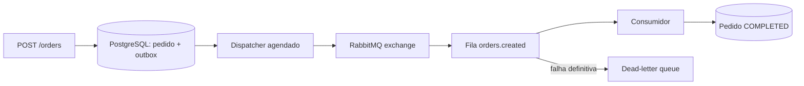

# OrderFlow API — Pedidos Assíncronos com RabbitMQ | Projeto 8/9

Projeto educacional de **Java Backend** com API REST, mensageria RabbitMQ, persistência PostgreSQL e padrão **Transactional Outbox**.

## Stack
Java 21+, Spring Boot 3.5.7, Spring Web, Spring Data JPA, Spring AMQP, RabbitMQ, PostgreSQL 16, Flyway, Bean Validation, JUnit 5, Mockito, Docker Compose e GitHub Actions.

## Fluxo de negócio



1. O endpoint cria o pedido com status `CREATED` e um evento na tabela `outbox_events`, na **mesma transação**.
2. Um publicador agendado lê eventos pendentes, envia ao RabbitMQ e aguarda confirmação do broker antes de marcá-los como publicados.
3. O consumidor processa o evento e altera o pedido para `COMPLETED`.
4. Entregas duplicadas são toleradas: `complete()` não modifica um pedido já concluído.
5. Mensagens rejeitadas pelo consumidor vão para a fila `orderflow.orders.dead` (DLQ), sem requeue automático.

**Semântica:** publicação/entrega *at-least-once*, **não** *exactly-once*. Uma falha entre a confirmação do broker e o commit do banco pode gerar duplicatas. O controle de status e `@Version` ajudam a tornar o processamento idempotente. O DLQ não tem reprocessamento automático.

## Executar no Eclipse

Requisitos: JDK 21+, Maven 3.9+, Docker com Compose.

```bash
docker compose up -d
mvn clean test
mvn spring-boot:run
```

No Eclipse: **File > Import > Maven > Existing Maven Projects**.

- API: http://localhost:8080
- PostgreSQL: localhost:5439
- RabbitMQ AMQP: localhost:5673
- RabbitMQ Management: http://localhost:15673 (login local `orderflow` / `orderflow`)

As credenciais do Compose são apenas para desenvolvimento. Em produção, use segredos, TLS e autenticação adequada.

## Endpoints

| Método | Rota | Resultado |
|---|---|---|
| POST | `/api/v1/orders` | `202 Accepted` e pedido `CREATED` |
| GET | `/api/v1/orders/{id}` | Consultar status |
| GET | `/api/v1/orders` | Listar pedidos |

### Criar pedido

```bash
curl -i -X POST http://localhost:8080/api/v1/orders \
  -H 'Content-Type: application/json' \
  -d '{"customerName":"Ana Souza","itemName":"Teclado","quantity":2}'
```

Resposta inicial (ilustrativa):

```json
{
  "id": 1,
  "customerName": "Ana Souza",
  "itemName": "Teclado",
  "quantity": 2,
  "status": "CREATED",
  "createdAt": "2027-01-01T12:00:00Z",
  "completedAt": null
}
```

Após alguns segundos, consulte `GET /api/v1/orders/1`: status esperado `COMPLETED` se o broker e o consumidor estiverem disponíveis.

## Testes e CI

`mvn clean test` executa testes **unitários** de domínio, serviço e consumidor, sem subir PostgreSQL/RabbitMQ. O workflow `.github/workflows/ci.yml` roda a mesma suíte a cada push e pull request.

## Limitações e próximos passos

- Projeto **educacional**, sem autenticação/autorização ou isolamento por usuário. Não exponha publicamente.
- O outbox usa varredura simples: **não suporta múltiplas instâncias do dispatcher sem coordenação** (`SKIP LOCKED`/lease). O confirm do broker não garante que a mensagem foi roteada a uma fila; para produção, adicionar `mandatory` + returns e testes de falha.
- A DLQ recebe falhas do consumidor, mas não possui ferramenta de replay; erros transitórios não são automaticamente repetidos.
- O consumo com `@Version` pode gerar conflito em atualizações concorrentes, que serão encaminhadas à DLQ sem retry.
- Não há pagamento, estoque, cancelamento, tracing, paginação, observabilidade nem testes de integração com containers.
- Não há garantia de ordem global entre eventos.

## O que explicar numa entrevista

**Mensageria assíncrona vs HTTP síncrono**, exchange/queue/binding/routing key, acknowledgements, dead-letter, publisher confirms, transações, outbox, consistência eventual, idempotência, concorrência e testes unitários.
